# Project 1: Sports Facility Booking System (ระบบจองสถานที่และสนามกีฬา)

รหัสนิสิต: **6730508321**

พัฒนาระบบ **Sports Facility Booking System** สำหรับค้นหา จัดการ และจองสนามกีฬา (สนามแบดมินตัน สนามเทนนิส สนามฟุตซอล ห้องออกกำลังกาย และสนามบาสเกตบอล) โดยแบ่งเป็น:
- **Backend (`backend/`)**: Node.js, Express 5, MongoDB (Mongoose), JWT Authentication & Role-Based Authorization, Swagger UI (`/api-docs`)
- **Frontend (`frontend/`)**: Next.js 15 (App Router), React 19, TypeScript, Tailwind CSS, Lucide Icons

---

## 1. User Interface Flow Design (Documentation)

- **Official Figma / FigJam Board**: [Sports Facility Booking - UI Flow Design](https://www.figma.com/board/MS3BG3C05BY7sJkbuGG6Cy?utm_source=other&utm_content=edit_in_figjam)
- **Figma Design Project**: [Figma Design Canvas](https://www.figma.com/design/3levmPxU4CJg8EMvz4tReB)

### UI Flow Architecture Diagram (Presentation Journey Steps 0 – 14)

```mermaid
flowchart LR
    subgraph publicFlow ["Lane 1: Public and Guest Discovery Flow"]
        startNode(["Start: Guest Visitor"]) --> step0["[Step 0] Intro: Project Scope and UI Flow"]
        step0 --> step1Reg["[Step 1] User Registration Form (/register)"]
        step1Reg --> valCheck{"Form Validation Check: Valid Email, Tel, Password >= 6"}
        valCheck -->|"Invalid Input"| errReg["Validation Error Toast / Alert"]
        errReg --> step1Reg
        valCheck -->|"Valid Input"| regSuccess["Account Created Successfully"]
        regSuccess --> step2Login["[Step 2] User Log-in Screen (/login)"]
        step2Login --> authCheck{"Credentials Validation Check"}
        authCheck -->|"Incorrect Password"| errLogin["Error 401: Invalid Credentials"]
        errLogin --> step2Login
        authCheck -->|"Auth Success"| jwtIssue["Issue JWT Bearer Token (Store in sessionStorage)"]
        jwtIssue --> roleBranch{"Role Check"}
        roleBranch -->|"Role: Member"| step3Catalog["[Step 3] Facility Catalog & Discovery (/)"]
        roleBranch -->|"Role: Admin"| step9AdminLogin["[Step 9] Admin Workspace Access (/admin)"]
        step3Catalog --> searchFilter["Filter Sport Types: Badminton, Tennis, Futsal, Gym, Basketball"]
        searchFilter --> viewDetail["[Click 'Book Facility'] Navigate to Court Detail"]
    end

    subgraph memberFlow ["Lane 2: Member Booking & Lifecycle Management Flow"]
        viewDetail --> step4Detail["[Step 4] Facility Detail & Interactive Booking (/facilities/id)"]
        step4Detail --> pickSlot["Select Booking Date + Visual Time-Slot Grid 06:00-22:00"]
        pickSlot --> priceCalc["Real-Time Price Calculator: Rate x Hours"]
        priceCalc --> submitBooking["Click 'Confirm Booking' Button"]
        submitBooking --> condCheck{"Booking Condition Validation Engine"}
        condCheck -->|"Date in the Past"| condFail1["Condition Error: Past Dates Disallowed"]
        condCheck -->|"Duration > 2.0 Hours"| condFail2["Condition Error: Maximum Limit Exceeded (0.5 - 2.0h)"]
        condCheck -->|"Member Booking Conflict"| condFail3["Condition Error: Overlapping Booking on Same Member"]
        condCheck -->|"Court Double-Booked"| condFail4["Condition Error: Time Slot Already Reserved by Other User"]
        condFail1 & condFail2 & condFail3 & condFail4 --> bookingRejected["Show Error Notification & Refresh Grid"]
        bookingRejected --> pickSlot
        condCheck -->|"All Conditions Passed"| createBookingSuccess["Booking Created (HTTP 201)"]
        createBookingSuccess --> step5MyBookings["[Step 5] View Own Bookings Screen (/bookings)"]
        step5MyBookings --> step6EditBooking["[Step 6] Edit Own Booking Modal (BookingEditModal)"]
        step6EditBooking --> editCondCheck{"Check Reschedule Slot Availability"}
        editCondCheck -->|"Conflict Detected"| editErr["Error: Selected Slot Unavailable"]
        editErr --> step6EditBooking
        editCondCheck -->|"Slot Available"| editSuccess["Update Booking Success (HTTP 200)"]
        editSuccess --> step5MyBookings
        step5MyBookings --> step7DeleteBooking["[Step 7] Delete / Cancel Own Booking Modal"]
        step7DeleteBooking --> confirmDelete{"Confirm Cancellation Dialog"}
        confirmDelete -->|"Confirm"| deleteSuccess["Booking Deleted Successfully"]
        deleteSuccess --> step5MyBookings
        step5MyBookings --> step8Logout["[Step 8] User Log-out Action"]
        step8Logout --> clearSession["Clear sessionStorage JWT Token"]
        clearSession --> step2Login
    end

    subgraph adminFlow ["Lane 3: Admin Workspace & Facility Management Flow"]
        step9AdminLogin --> adminVerify{"Verify Admin Authorization"}
        adminVerify --> step10AdminBookings["[Step 10] View Any Booking Master Table (/admin?tab=bookings)"]
        step10AdminBookings --> step11AdminEdit["[Step 11] Admin Update Any Booking Modal"]
        step11AdminEdit --> adminUpdateSuccess["Admin Override Booking Updated"]
        adminUpdateSuccess --> step10AdminBookings
        step10AdminBookings --> step12AdminDelete["[Step 12] Admin Delete Any Booking"]
        step12AdminDelete --> adminDelSuccess["Booking Removed by Admin"]
        adminDelSuccess --> step10AdminBookings
        step9AdminLogin --> step13AdminFacilities["[Step 13] Admin Create / Manage Facility (/admin?tab=facilities)"]
        step13AdminFacilities --> addFacilityForm["Fill Facility Modal: Name, Sport, Rate, Hours, Image"]
        addFacilityForm --> valFacility{"Validate Facility Inputs"}
        valFacility -->|"Valid"| facilityCreated["New Facility Created (Appears in Catalog)"]
        facilityCreated --> step3Catalog
        step9AdminLogin --> adminAnalytics["Admin Analytics Dashboard: Total Revenue, Hours, Court Popularity"]
    end

    subgraph extraCredits ["Lane 4: Extra Credit Features Hub (Step 14)"]
        direction TB
        exGrid["[Extra 1] Interactive 30-min Visual Time-Slot Grid (Available, Booked, Mine, Conflict)"]
        exQR["[Extra 2] Digital QR Booking Pass Modal & Print Receipt"]
        exCSV["[Extra 3] Export Booking History to CSV File"]
        exSession["[Extra 4] Multi-Tab Independent Session via sessionStorage"]
        exAnalytics["[Extra 5] Admin Analytics Dashboard with Live Revenue Metrics"]
        exLang["[Extra 6] Instant Bilingual UI Toggle (Thai / English)"]
    end

    step4Detail -.->|"Powered by"| exGrid
    step5MyBookings -.->|"Open Modal"| exQR
    step5MyBookings -.->|"Download"| exCSV
    jwtIssue -.->|"Architecture"| exSession
    adminAnalytics -.->|"Data Source"| exAnalytics
    step0 -.->|"Global Feature"| exLang
```



---

## 2. ความสามารถของระบบตามโจทย์ (Core Functionalities)

1. **User Management**:
   - รองรับผู้ใช้ 2 roles: `admin` และ `member`
   - ลงทะเบียนระบุ `name`, `email`, `tel`, `role`, และ `password`
   - Login / Logout ด้วย `email` และ `password` พร้อมรับ JWT Token (`Authorization: Bearer <token>`)
2. **Sports Facility Management**:
   - ผู้ใช้ทุกคนดูรายการและรายละเอียด Sports Facility ได้ (`name`, `sportType`, `location`, `capacity`, `hourlyRate`)
   - `admin` สามารถเพิ่ม (Add), แก้ไข (Update), ลบ (Delete), และดู (View) ข้อมูล Sports Facility
3. **Facility Booking Management**:
   - `member` สามารถสร้างการจองโดยระบุ `facility id`, `bookingDate`, `startTime`, และ `durationHours`
   - `member` สามารถดู แก้ไข และลบการจองของตนเอง
   - `admin` สามารถดู แก้ไข และลบการจองของ user คนใดก็ได้
4. **Conditions (เงื่อนไขการจอง)**:
   - วันที่จองต้องไม่เป็นวันก่อนหน้าวันปัจจุบัน
   - จองได้สูงสุดไม่เกิน **2 ชั่วโมง** ต่อ 1 การจอง (`0.5` - `2.0` ชั่วโมง)
   - `member` คนเดียวกันสร้างการจองที่มีเวลาซ้อนทับกันไม่ได้
   - `facility` เดียวกันถูกจองซ้อนเวลาโดยผู้ใช้มากกว่า 1 รายไม่ได้

---

## 3. Additional Functionalities (ฟีเจอร์เสริม)

- **Interactive Visual Time-Slot Availability Grid**: ตารางตรวจสอบช่วงเวลาว่างราย 30 นาที (`06:00` - `22:00`) แยกสีสถานะระหว่าง *ว่าง (Available)*, *คุณจองไว้แล้ว (Your Booking)*, *ชนคิวคุณในสนามอื่น (Member Conflict)*, และ *มีผู้อื่นจองแล้ว (Booked)*
- **Real-Time Price Calculator**: คำนวณค่าบริการอัตโนมัติ (`hourlyRate × durationHours`) ก่อนกดยืนยัน
- **Multi-Tab Independent Session (`sessionStorage`)**: สามารถเปิด 2 Tab ในเบราว์เซอร์เดียวกันเพื่อล็อกอิน `admin` และ `member` ควบคู่กันขณะสาธิตได้ทันที
- **Digital QR Booking Pass & Print Receipt**: บัตรผ่านเข้าสนามพร้อม QR Code และรหัสอ้างอิง สั่งพิมพ์หรือบันทึกเป็น PDF ได้
- **Export Bookings to CSV**: ส่งออกข้อมูลการจองเป็นไฟล์ `.csv`
- **Admin Analytics Dashboard**: สรุปยอดรายได้ประเมินรวม จำนวนชั่วโมงการจอง และกราฟสัดส่วนความนิยมของแต่ละสนาม
- **Bilingual UI (TH / EN)**: สลับภาษาไทย / อังกฤษ ได้ทันทีจากแถบเมนูด้านบน

---

## 4. วิธีติดตั้งและรันโปรแกรม (Setup & Run)

### 1) ตั้งค่าและรัน Backend (`http://localhost:5000`)
```bash
cd backend
npm install
# ตั้งค่า MONGO_URI ในไฟล์ backend/config/config.env
npm run seed       # สร้างข้อมูลตัวอย่าง (Users 3 บัญชี, Facilities 6 แห่ง, Bookings 5 รายการ)
npm run dev        # รัน Backend ที่ http://localhost:5000 (Swagger: http://localhost:5000/api-docs)
```

### 2) ตั้งค่าและรัน Frontend (`http://localhost:3000`)
```bash
cd frontend
npm install
npm run dev        # รัน Frontend ที่ http://localhost:3000
```

### บัญชีผู้ใช้งานตัวอย่าง (Seeded Accounts)
| Role | Email | Password |
|---|---|---|
| **Admin** | `admin@sportbooking.com` | `password123` |
| **Member 1** | `member1@sportbooking.com` | `password123` |
| **Member 2** | `member2@sportbooking.com` | `password123` |
