# Project 1: Sports Facility Booking System (ระบบจองสถานที่และสนามกีฬา)

รหัสนิสิต: **6730508321**

พัฒนาระบบ **Sports Facility Booking System** สำหรับค้นหา จัดการ และจองสนามกีฬา (สนามแบดมินตัน สนามเทนนิส สนามฟุตซอล ห้องออกกำลังกาย และสนามบาสเกตบอล) โดยแบ่งเป็น:
- **Backend (`backend/`)**: Node.js, Express 5, MongoDB (Mongoose), JWT Authentication & Role-Based Authorization, Swagger UI (`/api-docs`)
- **Frontend (`frontend/`)**: Next.js 15 (App Router), React 19, TypeScript, Tailwind CSS, Lucide Icons

---

## 1. User Interface Flow Design (Documentation)

- **Official Figma / FigJam Board**: [Project 1 - UI Flow Design (SportArenaHub)](https://www.figma.com/board/nBTXfvqdUDtgWkKxefCg2z/Project-1---UI-Flow-Design?node-id=0-1&t=tl3LUihAJPVZ5cwo-1)
- **Interactive Local Viewer**: [`docs/ui-flow-viewer.html`](docs/ui-flow-viewer.html)

### ตารางจับคู่เกณฑ์การให้คะแนนกับหน้าจอ Click Flow บน FigJam (14 หัวข้อหลัก)

| ลำดับ | หัวข้อตามเกณฑ์การให้คะแนน | Function Specification (EN) | คะแนน | หน้าจอบน FigJam Board (Click Flow) |
|---|---|---|---|---|
| **1** | User ทั่วไปลงทะเบียน | **User Registration + Validation Check** | 2 | **1. ลงทะเบียน (`/register`)** → กด `ลงทะเบียน` → หน้าแรก (`/`) |
| **2** | User ทั่วไป log-in | **User Log-in** | 1 | **2. เข้าสู่ระบบ (`/login`)** → กด `เข้าสู่ระบบ` → หน้าแรก (`/`) |
| **3** | User ทั่วไปเข้า View Product/Item | **User View Product/Item** | 1 | **3. ดูรายการสนามกีฬา (`/`)** → กด `จองสนาม` → **4. รายละเอียดสนาม (`/facilities/[id]`)** |
| **4** | User ทั่วไปสร้าง Booking/Request/Order | **User Create Booking/Request/Order** | 2 | **4. เลือกวันและเวลา** → กด `จองสนามนี้` → **4. ยืนยันการจอง (Step 1/2)** → **4. จองสำเร็จ (Step 2/2)** |
| **5** | + ทดลองการสร้างไม่ตรงเงื่อนไข | **Check Create Condition** | 1 | **5. ทดลองสร้างไม่ตรงเงื่อนไข (Error State)** — แสดงแถบแจ้งเตือนสีแดง + ปิดปุ่ม `จองสนามนี้` |
| **6** | แสดง Booking/Request/Order ที่สร้างไว้ | **User View Own Booking/Request/Order** | 2 | **6–8. การจองของฉัน (`/bookings`)** — แสดงรายการจองของตนเอง (`กำลังจะมาถึง` / `เสร็จสิ้น` / `ยกเลิก`) |
| **7** | User ทั่วไป update Booking/Request/Order | **User Edit Own Booking/Request/Order** | 2 | **6–8. การจองของฉัน** → กด `เลื่อนเวลา` → **7. แก้ไขการจอง (`BookingEditModal`)** |
| **8** | User ทั่วไป delete Booking/Request/Order | **User Delete Own Booking/Request/Order** | 2 | **6–8. การจองของฉัน** → กด `ยกเลิก` → **8. ยกเลิกการจอง (`ConfirmDialog`)** |
| **9** | User ทั่วไป log-out | **User Log-out** | 1 | กด `👤 สมชาย ▾` → **9. ออกจากระบบ (Navbar Menu)** → กด `ออกจากระบบ` → `/login` |
| **10** | Admin log-in | **Admin Log-in** | - | **2. เข้าสู่ระบบ (`/login`)** → เข้าสู่ **10–13. แอดมินจัดการการจอง (`/admin`)** |
| **11** | แสดง Booking ที่มีการสร้างเอาไว้ | **Admin View Any Booking** | 2 | **10–13. แอดมินจัดการการจอง (`/admin • จัดการการจอง`)** — แสดงรายการจองของสมาชิกทุกคน |
| **12** | Admin Update Booking | **Admin Edit Any Booking** | 2 | กด `•••` → `แก้ไขวัน/เวลา` → **12. Admin แก้ไขการจอง (`BookingEditModal`)** |
| **13** | Admin Delete Booking | **Admin Delete Any Booking** | 1 | กด `•••` → `ยกเลิกการจอง` → **13. Admin ลบการจอง (`ConfirmDialog`)** |
| **14** | Admin Create Product/Item | **Admin Create New Product/Item** | 1 | เมนู `จัดการสนาม` → **14. แอดมินจัดการสนาม** → กด `+ เพิ่มสนาม` → **14. เพิ่มสนามกีฬาใหม่ (`FacilityModal`)** |

### Code-Accurate UI Flow & Wireflow Specification (4 Architectural Swimlanes)

```mermaid
flowchart LR
    subgraph lane1 ["Lane 1: Public & Guest Discovery Flow (/, /facilities/[id], Global Navbar)"]
        L1Start(["Actor Entry: Public Visitor / Member"]) --> L1Home["[Screen] Facility Catalog & Discovery (/) — HomePage"]
        L1Start -.->|"Global Header"| L1Navbar["[Component] Global Navbar (Navbar.tsx): Language Toggle TH/EN, Saved Courts, Auth Menu"]
        L1Home -->|"Mount"| L1FetchFac[["API: GET /api/v1/facilities (isActive: true)"]]
        L1FetchFac --> L1LoadState{"Catalog Fetch & Filter State?"}
        L1LoadState -->|"Loading / Error / 0 Match"| L1Fallback["[UI States] 6x CourtCardSkeleton / ErrorState (Retry) / EmptyState (Reset Filters)"]
        L1Fallback -.->|"Retry / Reset"| L1Home
        L1LoadState -->|"Courts Loaded"| L1CourtGrid["[View] Available Courts Grid (CourtCard.tsx)"]
        L1SearchFilter["[Control] SearchBar + Sport Category Tabs (ALL, Badminton, Tennis, Futsal, Basketball, Gym)"] -->|"Filter"| L1CourtGrid
        L1FilterDrawer("[Drawer] Filter & Sort Courts: Max Hourly Rate Slider & Sort Order") -->|"Apply"| L1CourtGrid
        L1Home -.->|"Click Policy Info"| L1RulesModal("[Modal] Club Booking Policy: >= Today, 0.5-2.0h, 06:00-22:00")
        L1CourtGrid -.->|"Click Heart"| L1FavToggle[["Toggle Favorite (useFavorites -> localStorage)"]]
        L1CourtGrid -->|"Click Book Court (?date=)"| L1DetailScreen["[Screen] Facility Detail & Schedule (/facilities/[id]) — FacilityDetailPage"]
        L1DetailScreen -->|"Load Schedule"| L1FetchAvail[["Parallel API: GET /facilities/:id & GET /facilities/:id/availability?date=YYYY-MM-DD"]]
        L1DetailScreen --> L1SlotGrid["[Component] Sticky Schedule Box: 14-Day Date Strip + 30-Min TimeSlotGrid (06:00-22:00)"]
        L1FetchAvail --> L1SlotGrid
        L1SlotGrid -->|"Select Date & 0.5-2.0h Range"| L1SlotStates("[Visual Grid States] Open, Selected Range, Your Booking, Other Court Conflict, Booked")
    end

    subgraph lane2 ["Lane 2: Authentication, JWT Session & Booking Draft Flow (/register, /login, AuthContext)"]
        L2AuthGate{"Click 'Book This Court': User Authenticated?"} -->|"Guest (!user)"| L2SaveDraft[["saveBookingDraft() in sessionStorage (sah_booking_draft)"]]
        L2SaveDraft -->|"Redirect ?redirect=/facilities/[id]"| L2LoginScreen["[Screen] User Log In (/login) — LoginPage"]
        L2LoginScreen -.->|"Click Sign Up"| L2RegScreen["[Screen] User Registration (/register) — RegisterPage"]
        L2LoginScreen -.->|"Click Forgot Password"| L2ForgotModal("[Modal] Reset Password (forgotModalOpen)")
        L2RegScreen -->|"Submit"| L2RegVal{"Validate: Name, Email (@), Tel >= 9, Pass >= 6"}
        L2RegVal -->|"Invalid Input"| L2RegErr["[Error State] Inline Field Errors / HTTP 400 Email in Use"]
        L2RegVal -->|"Valid"| L2RegAPI[["API: POST /api/v1/auth/register (Role: member, HTTP 201 + JWT)"]]
        L2RegAPI -.->|"HTTP 400"| L2RegErr
        L2LoginScreen -->|"Submit"| L2LoginVal{"Validate: Email (@) & Password Required"}
        L2LoginVal -->|"Invalid Input"| L2LoginErr["[Error State] HTTP 401 Invalid Email or Password Alert"]
        L2LoginVal -->|"Valid"| L2LoginAPI[["API: POST /api/v1/auth/login (HTTP 200 + JWT)"]]
        L2LoginAPI -.->|"HTTP 401"| L2LoginErr
        L2RegAPI & L2LoginAPI --> L2SessionStore[["AuthContext: Store sf_token & sf_user in sessionStorage + GET /api/v1/auth/me"]]
        L2SessionStore --> L2RouteDecision{"Post-Auth Redirect & Role Check"}
        L2RouteDecision -->|"Has ?redirect Param"| L2RestoreDraft["[Redirect] Return to /facilities/[id] & consumeBookingDraft()"]
        L2RouteDecision -->|"Role: member"| L2GoCatalog(["[Redirect] Navigate to Facility Catalog (/)"])
        L2RouteDecision -->|"Role: admin"| L2GoAdmin(["[Redirect] Navigate to Admin Workspace (/admin)"])
        L2LogoutAction["Action: Click 'Log Out' -> GET /api/v1/auth/logout + clearStoredAuth()"] -.->|"Redirect /login"| L2LoginScreen
    end

    subgraph lane3 ["Lane 3: Member Booking Checkout, Lifecycle & Account Flow (/facilities/[id], /bookings)"]
        L3ClickBook["Action: Member Clicks 'Book This Court' CTA"] --> L3ClientVal{"6-Rule Pre-Checkout Check: >=Today, Future Slot, 0.5-2.0h, 06:00-22:00, No Court/Member Overlap"}
        L3ClientVal -->|"Rule Violated"| L3ValError["[Error State] Inline Rose Alert Banner & CTA Disabled"]
        L3ClientVal -->|"All 6 Rules Pass"| L3CheckoutStep1("[Modal] 2-Step Checkout — Step 1: Review & Confirm (Pay at Venue, Optional Note)")
        L3CheckoutStep1 -->|"Click Confirm Booking"| L3CreateAPI[["API: POST /api/v1/bookings (Bearer Token)"]]
        L3CreateAPI --> L3ServerVal{"Backend Validation & Conflict Engine"}
        L3ServerVal -->|"HTTP 400 / 409 Conflict"| L3CheckoutConflict["[Error State] Slot Just Taken Alert -> Pick Another Time Slot & Refresh Grid"]
        L3ServerVal -->|"HTTP 201 Created"| L3CheckoutStep2["[Modal] 2-Step Checkout — Step 2: Confirmed (Ref: SAH-XXXXXX)"]
        L3CheckoutStep2 --> L3PostConfirmCTA["Actions: 1. My Bookings (/bookings) | 2. Add Google Calendar | 3. Browse More (/)"]
        L3PostConfirmCTA -->|"Click My Bookings"| L3BookingsScreen["[Screen] My Bookings & Account (/bookings) — BookingsPage"]
        L3BookingsScreen --> L3TabsControl["[Navigation] 5 Tabs: Upcoming, Completed, Cancelled (localStorage), Saved Courts, Profile"]
        L3TabsControl -.->|"Profile / Saved Tab"| L3ProfileModal("[Tab / Modal] ProfileFavoritesModal: Update Name/Tel, Change Password, Saved Courts")
        L3TabsControl -->|"Click View Details"| L3PassModal("[Modal] BookingPassModal: SAH-XXXXXX Ref, QR Code, Print Receipt, Google Calendar")
        L3TabsControl --> L3ModCheck{"Is Booking Modifiable? (!isBookingStartedOrPast && !isCancelled)"}
        L3ModCheck -->|"Started / Completed / Cancelled"| L3LockedState["[Read-Only State] Completed or Cancelled (Edit/Cancel Hidden)"]
        L3ModCheck -->|"Click Reschedule"| L3EditModal("[Modal] BookingEditModal: Court Locked, Pick New Date + TimeSlotGrid")
        L3ModCheck -->|"Click Cancel"| L3CancelDialog("[ConfirmDialog] Cancel Court Reservation with Reopening Policy Notice")
        L3EditModal -->|"Save Changes"| L3UpdateAPI[["API: PUT /api/v1/bookings/:id (HTTP 200 / 409)"]]
        L3CancelDialog -->|"Confirm Cancel"| L3DeleteAPI[["API: DELETE /api/v1/bookings/:id + saveCancelledBooking() to localStorage"]]
        L3UpdateAPI & L3DeleteAPI --> L3ToastRefresh["[Success State] Toast Notification + Refresh GET /api/v1/bookings"]
        L3ToastRefresh -.->|"Refresh"| L3BookingsScreen
    end

    subgraph lane4 ["Lane 4: Admin Workspace & Venue Operations Flow (/admin 6 Modules + Facility CRUD)"]
        L4AdminScreen["[Screen] Admin Workspace (/admin) — AdminDashboardPage"] --> L4RoleGuard{"Verify Admin Role (user?.role === 'admin')"}
        L4RoleGuard -->|"Guest / Member"| L4GuardFail["[Guard State] 403 Administrator Access Required + Back to Home (/)"]
        L4RoleGuard -->|"Role === 'admin'"| L4AdminShell["[Layout] Admin Shell: Collapsible 6-Module Sidebar, Quick Search, Activity Bell, + Add Court"]
        L4AdminShell --> L4ModDashboard["[Module 1] Venue Operations Overview (dashboard): 4 KPIs, 7-Day Revenue Chart, Popular Courts"]
        L4AdminShell --> L4ModTimeline["[Module 2] Court Schedule Timeline (timeline): 06:00-22:00 Grid Grouped by Sport"]
        L4ModTimeline -->|"Click Grid Cell"| L4TimelineDrawers("[Drawers] Booked Cell -> Booking Details Drawer | Open Cell -> Available Slot Drawer")
        L4ModDashboard --> L4ModBookings["[Module 3] Manage All Bookings (bookings): Search, Status/Sport/Date Filter, Sort, Pagination"]
        L4ModBookings -->|"Row Action Menu"| L4AdminBookModals("[Overlays] BookingPassModal | BookingEditModal | Cancel ConfirmDialog")
        L4TimelineDrawers -.->|"Reschedule / Cancel"| L4AdminBookModals
        L4AdminBookModals --> L4AdminBookAPIs[["Admin Override APIs: PUT /api/v1/bookings/:id | DELETE /api/v1/bookings/:id"]]
        L4ModBookings --> L4ModFacilities["[Module 4] Manage Sports Courts (facilities) + Inline Admin Controls on (/) & (/facilities/[id])"]
        L4ModFacilities -->|"Add / Edit Court"| L4FacilityModal("[Modal] FacilityModal: Name, Sport, Location, Capacity, Rate, Hours, Photo URL")
        L4ModFacilities -->|"Delete Court"| L4DeleteCourtDialog("[ConfirmDialog] Delete Sports Court Confirmation")
        L4FacilityModal --> L4CreateUpdateFacAPI[["Facility Write APIs: POST /api/v1/facilities (201) | PUT /api/v1/facilities/:id (200)"]]
        L4DeleteCourtDialog --> L4DeleteFacAPI[["Soft-Delete API: DELETE /api/v1/facilities/:id (sets isActive: false)"]]
        L4CreateUpdateFacAPI & L4DeleteFacAPI --> L4SyncCatalog["[Success State] Toast Notification + Refresh Admin Tables & Public Catalog (/)"]
        L4ModFacilities --> L4ModUsers["[Module 5] Members & Booking Activity (users): AggregatedBookings, Hours & Total Spend"]
        L4ModUsers --> L4ModSettings["[Module 6] System Booking Rules (settings): 0.5-2.0h Limits, 06:00-22:00, Overlap Protection"]
    end

    L1SlotGrid -->|"Click Book This Court"| L2AuthGate
    L1Navbar -.->|"Click Log In / Sign Up"| L2LoginScreen
    L2AuthGate -->|"Authenticated Member"| L3ClickBook
    L2RestoreDraft -.->|"Restore Draft"| L1SlotGrid
    L2GoCatalog -.->|"Navigate /"| L1Home
    L2GoAdmin -->|"Navigate /admin"| L4AdminScreen
    L3BookingsScreen -.->|"Click Log Out"| L2LogoutAction
```



---

## 2. ความสามารถของระบบตามโจทย์ (Core Functionalities)

1. **User Management**:
   - รองรับผู้ใช้ 2 roles: `admin` และ `member`
   - ลงทะเบียนระบุ `name`, `email`, `tel`, `role`, และ `password`
   - Login / Logout ด้วย `email` และ `password` พร้อมรับ JWT Token (`Authorization: Bearer <token>`)
2. **Sports Facility Management**:
   - ผู้ใช้ทุกคนดูรายการและรายละเอียด Sports Facility ได้ (`name`, `sportType`, `location`, `capacity`, `hourlyRate`)
   - `admin` สามารถเพิ่ม (Add), แก้ไข (Update), ลบ (Delete), และดู (View) ข้อมูล Sports Facility
3. **Facility Booking Management**:
   - `member` สามารถสร้างการจองโดยระบุ `facility id`, `bookingDate`, `startTime`, และ `durationHours`
   - `member` สามารถดู แก้ไข และลบการจองของตนเอง
   - `admin` สามารถดู แก้ไข และลบการจองของ user คนใดก็ได้
4. **Conditions (เงื่อนไขการจอง)**:
   - วันที่จองต้องไม่เป็นวันก่อนหน้าวันปัจจุบัน
   - จองได้สูงสุดไม่เกิน **2 ชั่วโมง** ต่อ 1 การจอง (`0.5` - `2.0` ชั่วโมง)
   - `member` คนเดียวกันสร้างการจองที่มีเวลาซ้อนทับกันไม่ได้
   - `facility` เดียวกันถูกจองซ้อนเวลาโดยผู้ใช้มากกว่า 1 รายไม่ได้

---

## 3. Additional Functionalities (ฟีเจอร์เสริมจากโค้ดจริง)

- **Interactive Visual Time-Slot Availability Grid (`TimeSlotGrid.tsx`)**: ตารางตรวจสอบช่วงเวลาว่างราย 30 นาที (`06:00` – `22:00`) แยกสีสถานะระหว่าง *ว่าง (Open)*, *ช่วงเวลาที่เลือก (Selected Range)*, *คุณจองไว้แล้ว (Your Booking)*, *ชนคิวคุณในสนามอื่น (Member Conflict)*, และ *มีผู้อื่นจองแล้ว (Booked)* พร้อมระบบเลือกช่วงเวลาว่างแรกให้อัตโนมัติ
- **2-Step Booking Checkout Modal & Guest Booking Draft (`sessionStorage`)**: หน้าต่างตรวจสอบรายการจองและยืนยัน 2 ขั้นตอน พร้อมระบบบันทึก Draft การจองอัตโนมัติ (`saveBookingDraft` / `consumeBookingDraft`) เมื่อผู้เยี่ยมชมกดจองแล้วยังไม่ได้เข้าสู่ระบบ
- **Digital QR Booking Pass, Print Receipt & Google Calendar (`BookingPassModal.tsx`)**: บัตรผ่านเข้าสนามพร้อมรหัสอ้างอิง (`SAH-XXXXXX`), QR Code, ปุ่มสั่งพิมพ์ใบจอง (`window.print()`) และปุ่มเพิ่มนัดหมายลง **Google Calendar** ทันที
- **Saved Courts / Favorites & Account Hub (`useFavorites` & `ProfileFavoritesModal.tsx`)**: ระบบบันทึกสนามกีฬาโปรด (`localStorage`) และจัดการข้อมูลส่วนตัว/รหัสผ่าน รวมถึงประวัติการจองที่ยกเลิกแล้ว
- **Admin 6-Module Workspace & Interactive Schedule Timeline (`app/admin/page.tsx`)**: แดชบอร์ดสรุป 4 KPIs, กราฟรายได้ 7 วัน, สนามยอดนิยม, ตาราง Timeline รายชั่วโมง (`06:00` – `22:00`) แยกตามประเภทกีฬาพร้อม Side Drawer, ระบบจัดการการจองทั้งหมด, จัดการสนามกีฬา (CRUD + Soft-Delete) และทำเนียบสมาชิก
- **Multi-Tab Independent Session (`sessionStorage`) & Bilingual UI (`TH / EN`)**: แยกเซสชันระหว่างแท็บเบราว์เซอร์เพื่อทดสอบ `admin` และ `member` พร้อมกันได้ทันที และสลับภาษาไทย / อังกฤษแบบเรียลไทม์

---

## 4. วิธีติดตั้งและรันโปรแกรม (Setup & Run)

### 1) ตั้งค่าและรัน Backend (`http://localhost:5000`)
```bash
cd backend
npm install
# ตั้งค่า MONGO_URI ในไฟล์ backend/config/config.env
npm run seed       # สร้างข้อมูลตัวอย่าง (Users 3 บัญชี, Facilities 6 แห่ง, Bookings 5 รายการ)
npm run dev        # รัน Backend ที่ http://localhost:5000 (Swagger: http://localhost:5000/api-docs)
```

### 2) ตั้งค่าและรัน Frontend (`http://localhost:3000`)
```bash
cd frontend
npm install
npm run dev        # รัน Frontend ที่ http://localhost:3000
```

### บัญชีผู้ใช้งานตัวอย่าง (Seeded Accounts)
| Role | Email | Password |
|---|---|---|
| **Admin** | `admin@sportbooking.com` | `password123` |
| **Member 1** | `member1@sportbooking.com` | `password123` |
| **Member 2** | `member2@sportbooking.com` | `password123` |
